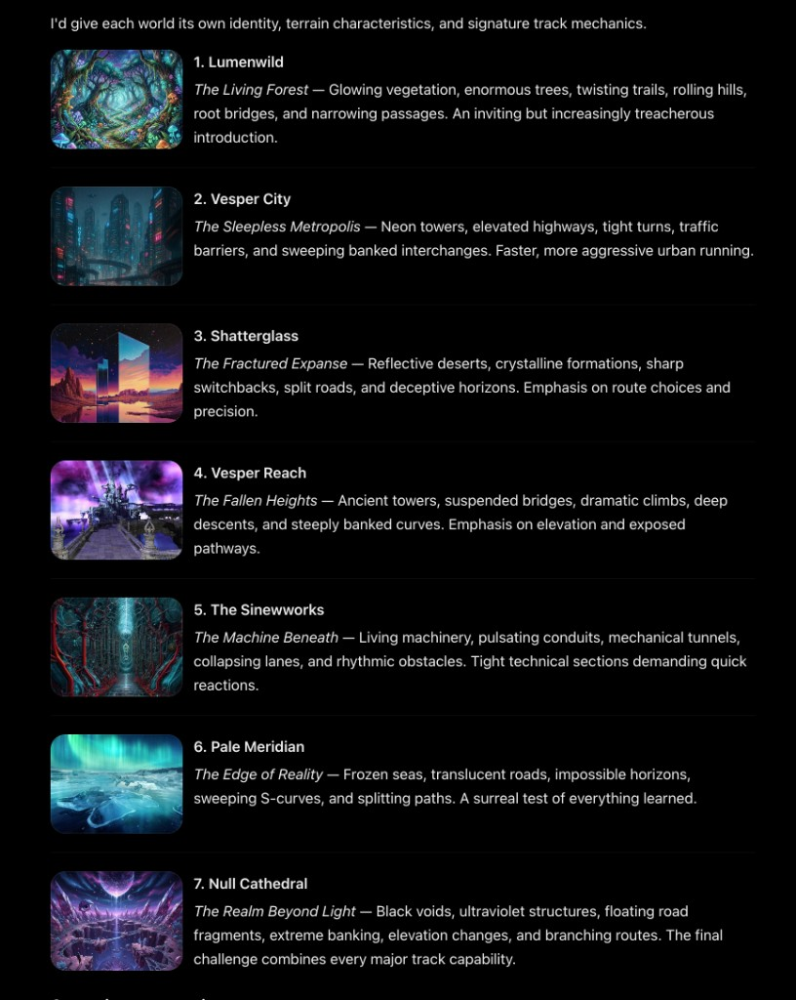

# Story worlds

Story Mode is these seven places, in this order. Each one is its own
environment on the track framework: light, scenery, and backdrop, on a
catalog track whose shape is the mechanic named here. Arcade Mode keeps
the tracks the game runs today.

Each world gets its own identity, terrain, and signature track mechanics.

## 1. Lumenwild

**The Living Forest.** Glowing vegetation, enormous trees, twisting
trails, rolling hills, root bridges, and narrowing passages. An inviting
but increasingly treacherous introduction.

Yaw, grade, and lane narrowing. This is the first story stage: the forest
in `level_lumenwild.c`, rebuilt onto a real track.

## 2. Vesper City

**The Sleepless Metropolis.** Neon towers, elevated highways, tight
turns, traffic barriers, and sweeping banked interchanges. Faster, more
aggressive urban running.

Yaw and bank, with denser obstacles.

## 3. Shatterglass

**The Fractured Expanse.** Reflective deserts, crystalline formations,
sharp switchbacks, split roads, and deceptive horizons. Emphasis on
route choices and precision.

Yaw and forks.

## 4. Vesper Reach

**The Fallen Heights.** Ancient towers, suspended bridges, dramatic
climbs, deep descents, and steeply banked curves. Emphasis on elevation
and exposed pathways.

Grade and bank.

## 5. The Sineworks

**The Machine Beneath.** Living machinery, pulsating conduits, mechanical
tunnels, collapsing lanes, and rhythmic obstacles. Tight technical
sections demanding quick reactions.

Lane changes.

## 6. Pale Meridian

**The Edge of Reality.** Frozen seas, translucent roads, impossible
horizons, sweeping S-curves, and splitting paths. A surreal test of
everything learned.

Yaw and forks, after the earlier mechanics have all appeared.

## 7. Null Cathedral

**The Realm Beyond Light.** Black voids, ultraviolet structures, floating
road fragments, extreme banking, elevation changes, and branching
routes. The final challenge combines every major track capability.

Bank, grade, and forks, plus gaps. Gaps are the one capability here the
game cannot run yet (`gap.drop` is still view-only).
